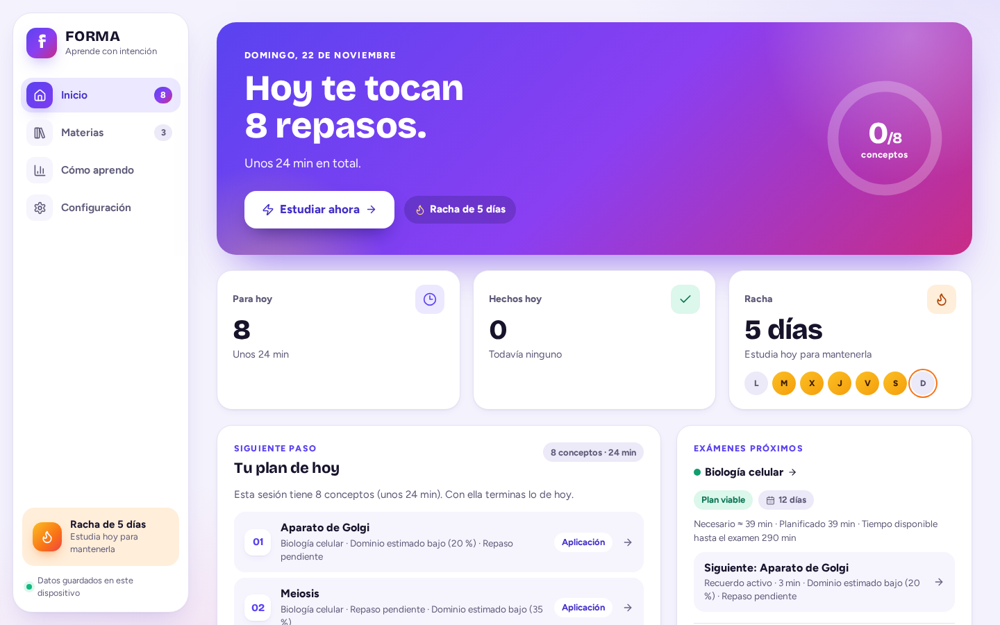
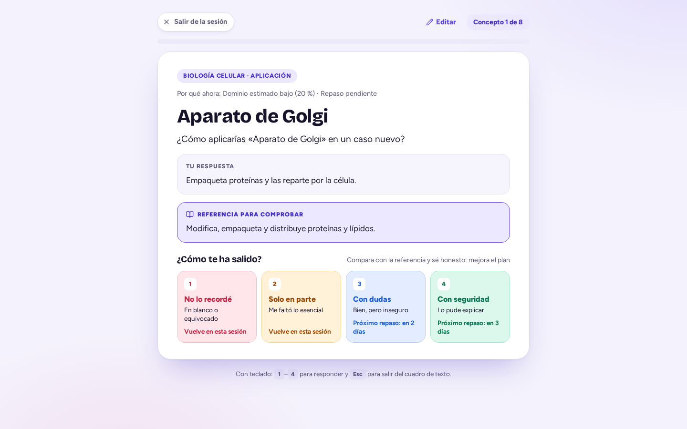
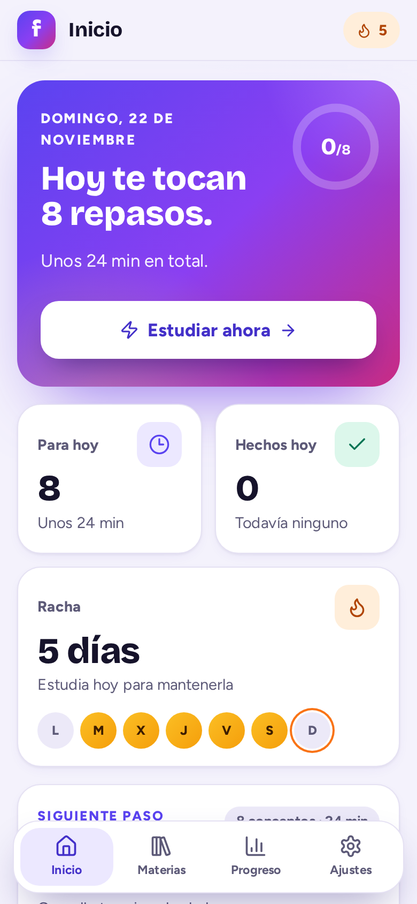

# FORMA — Adaptive Learning (v0.7.0)

FORMA is a Spanish-language responsive learning PWA prototype focused on concepts, deliberate practice, review scheduling, and cautious summaries of a learner's self-reported evidence.

## Features in this package
- Redesigned interface (v0.7): violet-to-magenta identity, a home screen that opens with what is due today and a progress ring, subject cards in each subject's colour, a distraction-free study session (navigation hidden while a card is open), colour-coded self-assessment, light and dark themes. Desktop has a floating sidebar, tablets an icon rail, and phones a bottom tab bar. Figtree and Bricolage Grotesque are bundled locally, so the app makes no request to Google Fonts.

| Home | Study session | Phone |
|---|---|---|
|  |  |  |

More screenshots in `docs/capturas/` (subjects, dark theme, session on a phone).
- Subject and concept library (create, search, sort, edit, delete), exam dates and basic mastery estimates. Each concept has an importance level and an optional estimate of minutes per review. A subject can be studied on its own, with only what is due or all of it (for the day before an exam), and «Guardar y añadir otro» lets you enter several concepts in a row. A subject can be archived when its exam is over: nothing is deleted, but its concepts stop appearing in reviews and on the home screen until it is restored.
- Home screen built around today: how many reviews are due and roughly how long they take, one «Estudiar ahora» button, reviews done today, a streak of consecutive study days with a seven-day strip, and when the next review falls if nothing is due. With an empty library it offers a six-concept sample subject («Probar con un ejemplo») so the study flow can be tried before typing anything.
- Practice session designed for retrieval rather than re-reading: (1) try to answer, optionally in writing; (2) say how well you think you know it *before* seeing the reference — this is the confidence that gets recorded; (3) compare with the reference (your written answer is shown next to it) and rate yourself with one tap. Each rating shows when the concept will come back. A failure asks, optionally, whether it was a recall failure, a misconception or carelessness.
- What you fail comes back in the same session, three cards later, up to twice («Segunda vuelta»). Only the first attempt is recorded and scheduled, so repeating a card cannot inflate mastery; the concept is still due the next day.
- Test mode («Tipo test»): the same question with three or four options, corrected automatically instead of self-rated. The wrong options are the ones written on the concept or, failing that, answers of other concepts of the same subject (preferring those that share a tag); it is offered only when at least two wrong options exist. The learner still predicts first; a correct answer after predicting «Bastante» or «Seguro» counts as a confident recall, a correct answer without that prediction as a hesitant one, and a wrong answer as a failure that comes back later in the session *without* options. A subject with enough concepts has a «Hacer un test» button.
- Keyboard study on desktop (`1`–`4` to predict and rate, `Enter`/space to continue, `Esc` to leave the answer box), one-step undo of the last answer, and a session that can be ended at any point with its summary.
- A study day starts at 04:00, so a session that runs past midnight still counts as the same day, and everything due at any time today is offered today.
- Spaced review with growing intervals (a confident answer: 1, 3, 6, 13, 28, 60, 129 days, capped at 180; a hesitant one grows slowly; a failure returns the next day). Extra practice of a concept that is not yet due never pushes its date further away. Concept prioritisation combining exam urgency, demonstrated mastery, forgetting risk, detected difficulties, importance and estimated time (3 minutes per review unless the learner sets another value on the concept).
- Exam planner (`src/planner.ts`): spreads active-recall, explanation and application work over the days left, never overloads a day, warns when time is insufficient and recalculates after every review. Starting the plan's next task opens the practice card with the activity the plan names.
- Difficulty diagnosis (`src/diagnosis.ts`): recall failure, misconception, application difficulty, over/under-confidence, slow retrieval, possible carelessness. Labelled *provisional* until at least moderate evidence exists.
- Evidence levels (`src/evidence.ts`): <3 insufficient, 3–6 initial, 7–14 moderate, ≥15 stronger. Orientative thresholds, not statistical guarantees; no method is declared superior on thin data.
- Session summary (`src/sessionSummary.ts`): studied, mastered *with evidence*, still difficult, errors to fix, what was repeated in the session and whether it came out the second time, what to review next, a concrete next activity and the total for the day.
- Import PDF with selectable text, DOCX, TXT, Markdown and CSV, or paste notes, as editable draft concepts: the name, question and reference answer of every proposed draft can be corrected, unticked or proposed again before saving, into an existing subject or a new one. Up to 60 drafts are reviewed at a time.
- CSV files are read one row per concept. Recognised header names: `concepto`, `pregunta`, `respuesta`, `aplicación`, `respuesta de aplicación`, `etiquetas` (accents optional, English equivalents accepted, `,` `;` or tab as separator). Without a header, two columns mean concept and answer, and three mean concept, question and answer.
- Source filename, PDF page and original excerpt are retained for imported concepts, even if the draft is edited. They are shown with the reference during practice and in the edit form; pasted text is labelled «Texto pegado».
- Local JSON backup and restore. Once there are 10 concepts or 20 recorded reviews, the home screen reminds the learner to export a copy if none was made in the last 14 days (it can be postponed for 3 days).
- Duplicate warning: the concept form and the import window flag a name that already exists in the same subject (ignoring accents, case and punctuation); the import window can untick all repeated drafts at once.
- Local-first storage, light/dark/system theme, basic PWA shell/offline fallback with a service worker whose scope and cache are relative to its folder (works on GitHub Pages project sites).
- Optional OpenAI-compatible adapter, off by default and with no API key included. When the learner enables it in Configuración (service address, model and, if required, a key), the import window gains «Proponer con IA»: it asks for confirmation naming the server, sends the source text and returns drafts to review. Each quoted excerpt is checked against the source text and flagged when it is not found there.
- Vitest unit tests for scheduling, state, import (including CSV) and the AI adapter (with a mocked server), the session queue and the daily summary, plus jsdom tests of the interface: main study flow, repetition of failed cards, keyboard answers, undo, test mode, archiving, duplicate warnings, the backup reminder, the home screen, studying a whole subject, import of pasted text and CSV, the optional AI flow, exam plan and modal Escape/focus restoration.

## Run locally
Requires Node.js 20+ recommended.

```bash
npm install
npm run check
npm test
npm run build
npm run dev
```

Open the local URL printed by Vite. To deploy, publish the generated `dist/` directory on any static host; the app has no client-side routes, so no rewrite rule is needed.

## Publish on GitHub Pages

GitHub Pages serves this repository from a subfolder (`/App-de-estudio/`), so the build must use relative asset paths:

```bash
npm run build:pages
```

Publishing is automatic: `.github/workflows/deploy.yml` runs on every push to `main` (and can be started by hand from the Actions tab), runs the type check and tests, builds with `npm run build:pages` and commits the contents of `dist/` to the `gh-pages` branch, which GitHub Pages serves. Nothing is published if the check or the tests fail. The app uses no client-side routes, so no SPA rewrite is needed. The manifest, icon and service worker are all referenced relatively; the service worker is registered with `import.meta.env.BASE_URL`, which is `./` in this build and `/` for a build served from a domain root (`npm run build`). The worker's shell cache is also relative, and it only deletes caches whose names start with `forma-`, because `github.io` shares its origin with other projects.

After changing the worker's cache strategy, bump `CACHE` in `public/sw.js` so clients replace the old cache.

## Privacy and AI
The app stores learning data in `localStorage` in the browser. It has no login, server database, cross-device synchronisation, analytics beacon or cloud backup. Clearing browser data can erase the only copy; export backups regularly.

The AI adapter is off by default, and with it off the app sends nothing to any server. When it is on:

- Text is sent only when the learner presses «Proponer con IA» in the import window and accepts the confirmation, which names the destination server.
- Only the source text in that window is sent (the first 12,000 characters). Subjects, saved concepts and review history are never sent.
- The service address and model are saved with the settings, so they are included in exported backups. The key is kept in `sessionStorage` until the tab is closed; it is never written to the app state or to backups.
- Requests go straight from the browser to the configured server, which must therefore accept browser (CORS) requests. `http://` addresses are accepted only for `localhost`.
- A key typed into a browser can be read by anyone with access to that browser profile. For a shared deployment, put a proxy you control in front of the provider instead of handing out keys.
- `VITE_FORMA_AI_BASE_URL` and `VITE_FORMA_AI_MODEL` (see `.env.example`) set the default address and model of a build. Never put a key in `.env`: `VITE_` variables are public in the bundle.

Only use a trusted server, and only send content you are allowed to share.

## Important limitations
- This is a prototype, not a production-ready education platform.
- There is no authentication, cloud sync, multi-user isolation, backend API, payments or account management.
- PDF import requires selectable text. Scanned PDFs and handwriting need OCR, not included here.
- Imported fragments are heuristics, not validated concept extraction. Review and edit every proposed concept.
- AI proposals are not validated either and can be wrong or invented; the «cita no encontrada» flag only shows that a quote is absent from the source, not that the rest is correct. The adapter has been tested against a mocked server only, not against a real provider.
- Self-evaluation is subjective. Mastery values are heuristics and must not be treated as grades.
- Scheduling is a small custom heuristic, not FSRS and not a scientifically validated memory model. The intervals are fixed multipliers; they do not adapt to how each learner forgets.
- The streak counts days with at least one recorded review. It is a habit cue, not evidence of learning.
- Test mode checks recognition, which is easier than recall: use it as a complement. Borrowed wrong options can be obviously unrelated when a subject mixes very different kinds of answers.
- Duplicate detection compares names only, not the content of the answer.
- The `sound` setting exists in the data model but has no interface.
- There is no independent delayed-retention experiment yet. Comparing methods is exploratory and must not be presented as proof of causality.
- PWA offline support is a basic shell cache; full browser/iPad testing is still required.
- See `VALIDATION.md` for exactly what has and has not been verified (e.g. real Safari/iPad, offline mode and screen-reader use are not yet verified).

## Repository layout
- `src/App.tsx`: app UI and interaction flow.
- `src/App.smoke.test.tsx`: DOM tests (jsdom) of the study session, home screen, subject screen, import, modal keyboard behaviour and the 0.7 navigation (bottom tab bar, focus mode during a session, progress ring).
- `src/domain.ts`: domain types.
- `src/engine.ts`: scheduling, state transforms and evidence aggregation.
- `src/evidence.ts`, `src/diagnosis.ts`, `src/priority.ts`, `src/planner.ts`, `src/sessionSummary.ts`, `src/dates.ts`: pure learning-engine modules (no UI), each with its own `*.test.ts`.
- `src/session.ts` (session queue and repetition of failed cards), `src/today.ts` (what is due today, streak, week), `src/choices.ts` (options of a test question), `src/duplicates.ts`, `src/backup.ts` (backup reminder) and `src/sample.ts` (sample subject), also pure and tested.
- `src/components/`: components for the practice card (`PracticeCard.tsx`), the exam plan, session summary, diagnosis chips, the import window (`ImportPanel.tsx`) and the optional AI settings (`AISettingsPanel.tsx`).
- `src/importer.ts`: file validation (format, empty, 15 MB limit), document extraction with clear errors, draft splitting with source page, CSV parsing and conversion of reviewed drafts into concepts.
- `src/analytics.ts`: aggregated summaries.
- `src/storage.ts`: local persistence and migration.
- `src/ai.ts`: optional OpenAI-compatible adapter: configuration checks, request, parsing of proposed concepts and verification of their quotes.
- `src/engine.test.ts`: unit tests.
- `supabase/schema.sql`: optional future backend schema only; the current app does not call it.

## Next engineering steps
1. Run install, check, test and build in CI (already configured in `.github/workflows/ci.yml`).
2. Validate on iPad Safari and extend the interface tests to PDF and DOCX files.
3. Add a backend with authentication, per-user data isolation and migrations before any cloud sync.
4. Add concept-level skill-target setup, content-based duplicate detection, and warn the learner when an edit changes a concept's content substantially.
5. Replace the heuristic schedule with a well-tested FSRS implementation and migration.
6. Add delayed checks to compare short-term confidence with later recall.
7. Extend keyboard/screen-reader testing, import progress and richer source-page mapping.
